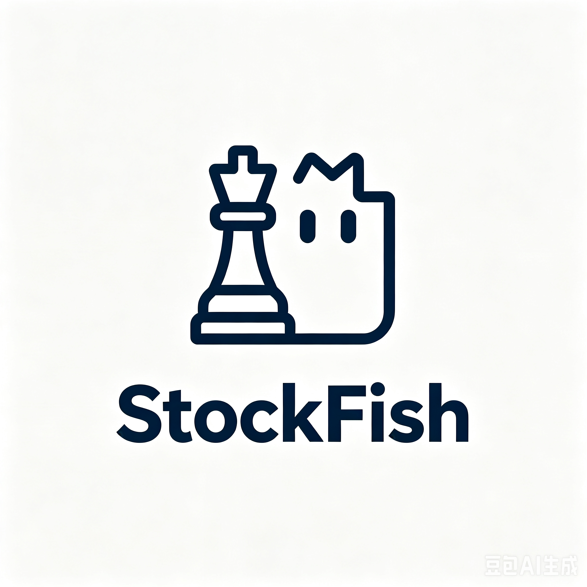

# StockFish · R05 主板候选研究操作手册

## Daily Observation Monitor（2026-09-23）

【事实】在 Codex 中说“检查今天有没有正常交付，并查看最近 20 个交易日”，可用 `daily-observation` 读取原状态、快照和跟踪计数，不触发荐股或采集。使用方式与 pending/missing 口径见 [观察工具说明](docs/PHASE1_OBSERVATION_MONITOR.md)。

## Phase 1 日报入口（2026-09-23）

【事实】本轮源码提供 `/daily-research` 只读日报页；Codex 可调用 `daily-report --target-session YYYY-MM-DD` 或 `daily-report --run-id RUN_ID`，并用 `daily-outcomes RUN_ID` 读取原推荐 T+1..T+20 价格观察。完整四类、原解释与身份保留；失败日显示原因，未知不填零。详见 [Phase 1 每日荐股闭环](docs/PHASE1_DAILY_RESEARCH_LOOP.md)。

【需要验证】本轮未切换现有服务、未完成在线连续交付与自然 20 会话验证。当前主动核心仍为 Python `STAGE_AWARE_MOMENTUM_V2`；下方 PV/R05 数据与测试数属于历史记录。

这是沪深主板强势股候选研究工具。在当前项目的 **Codex 对话中直接提出研究请求**，Codex 读取已保存结果、调用现有产品 API 并保存报告；网页是可选入口。完整名单、焦点和持续跟踪分别保留，候选数量由正式条件决定。当前使用 PV 观察链路作为日常研究语境，但它仍是 R05 实验，不替代正式 DAILY 配置。

## 直接在 Codex 里使用

在 `D:/StockRecommendation` 或业务目录 `stock-fish` 的 Codex 项目中，可以直接说：

- “给我下一交易日的完整研究名单，注明数据日期、缺口和仍在跟踪的股票。”
- “写一份当前短线市场与个股报告，区分事实、规则计算、你的判断和未知。”
- “昨天那份候选后来怎样？读取原名单并继续跟踪，未成熟的单独列出。”
- “解释当前规则的指标、权重和研究理念。”
- “国芳集团为什么入围却没进焦点？引用保存名单里的依据和风险。”
- “按新要求给我下一交易日名单；没有题材或资金证据就明确写 UNKNOWN，不要用旧PV冒充阶段感知正式名单。”
- “哪些股票处于高位分歧但修复很强？哪些属于趋势整理？”
- “给我最新全面项目综述，供新的网页 AI 对话讨论；先只讨论，不修改策略。”

实际入口：[Codex 日常操作协议](docs/CODEX_DAILY_RESEARCH.md) · [阶段感知 V2 核心框架](docs/STAGE_AWARE_MOMENTUM_V2.md) · [新版板块资金趋势说明](docs/THEME_CAPITAL_TREND_V1.md) · [全面项目综述](docs/PROJECT_OVERVIEW.md) · [本次首用验证](docs/CODEX_FIRST_USE_VERIFICATION.md) · [项目 Agent 指引](AGENTS.md)。Codex 使用 [轻量调用脚本](scripts/codex_research.py)，用户无需自己执行命令。完整导出与报告保存在本机被 Git 忽略的 `reports/codex/`；权威运行保存在 `data/stockfish.sqlite3` 与 `data/core/`，这些私有数据不随源码上传。

普通研究允许读取、按请求更新现有研究和保存报告；**不自动授权改正式策略、生产代码或提交推送**。讨论变更先讨论，明确要求实施才进入开发。付费调用、模型升级和预算扩大需单独授权。网页内聊天、自动模型路由和统一模型费用面板未实现；当前 Codex 可以组织研究，不代表应用内 LLM 已接通。

| 工作 | 初始分工建议 | 当前状态与升级边界 |
|---|---|---|
| 读保存结果、资格、排名、统计、导出 | 确定性程序 | 无需应用 LLM，不重复让模型计算 |
| 日常解释、报告、综述、简单文档或小修复 | 用户可先选 5.5 或较便宜模型 | 保持当前选择；尚未进行本项目多模型成本/质量评测 |
| 已定位的复杂时序、来源冲突或统计难题 | 先缩小问题并做普通核验 | 确有必要时申请更强模型定向复核，不默认升级 |

**历史核对：2026-09-07（上海时间）。** 实际本地服务曾核验为 [http://127.0.0.1:8000/](http://127.0.0.1:8000/)，运行于 `D:/StockRecommendation/stock-fish`；发布仓库 `publish/stockfish-qlib-quant-system` 的历史核验基础为 main / `bff88593089faa3cb80a5d7d0a339d1c74ecaeb7`。当前 D 盘克隆已将阶段感知重构为主动核心 `STAGE_AWARE_MOMENTUM_V2`；`THEME_CAPITAL_TREND_V1` 保留为对照，`STAGE_AWARE_MOMENTUM_V1` 保留为历史只读兼容；最终提交以仓库历史和交付回复为准。

本次默认库读取的是 **9 月 4 日真实历史重建输入，PV 完整 525 只、焦点 17 只，覆盖 LIMITED_SCOPE，成熟后验为 0**；不是 9 月 7 日新行情。后文引用的 R05 多日回放、752 项工程回归等属于此前独立证据，不是当前默认库拥有相同历史，也不是本次重跑。缺行情、未成熟后验或应用 LLM 未配置不阻止保存名单、详情、导出和有限研究。

目录：

1. [系统定位与当前能力](#capabilities)
2. [首次启动与配置](#startup)
3. [每天怎么用](#daily)
4. [研究指令与结果解读](#research)
5. [模型分工与升级](#models)
6. [预算、权限、隐私与故障处理](#operations)
7. [开发维护与模型评估](#maintenance)
8. [规划、历史能力与参考资料](#references)

## 1. 系统定位与当前能力

研究范围是沪深主板，排除创业板、科创板和北交所；日期化资格、上市时长、ST/停牌等条件按实际证据校验。无需提供账户、现金或持仓。本系统不连接券商、不下单，最终交易由用户自行决定。策略参数属于研究假设，排名分不是上涨概率，市场有效性仍为 `NOT_ESTABLISHED`。

当前分工是：程序校验数据、执行冻结公式并保存研究记录；项目中的 Codex 根据用户请求读取证据、组织研究和报告。网页仍可独立看榜，应用内聊天与工具编排尚未实现。Codex 的普通研究权限与修改生产代码的权限分开。`STAGE_AWARE_MOMENTUM_V2` 是当前主动核心强势股策略，先识别 `START / ACCELERATION / HIGH_LEVEL_REPAIR / TREND_PULLBACK`，再分离行为确认、市场兼容、同题材板块/资金和关键反证；`THEME_CAPITAL_TREND_V1` 仍作为对照。初始研究参数在报告中必须标明 **尚未验证**，`MARKET_EDGE=NOT_ESTABLISHED`。

下表的“实现”“验证”“数据/权限”分别判断。**“引用既有证据”指已结束的 R05 整改执行，不是本次文档任务重新实测。**

| 能力 | 实现情况 | 验证情况 | 最近证据中的数据/权限及限制 |
|---|---|---|---|
| 独立 PV、焦点筛选、保存与稳定排序 | 已实现 | 引用真实回放、golden 与 API 证据 | 主五日沪深日期化资格可用；可比价格、历史及字段仍有缺口 |
| 历史选择、全部/焦点/未入焦点、分页、详情、JSON/CSV | 已实现 | 引用实际页面和两日期 HTTP 证据 | 读取已登记运行；没有记录时不会自动造榜 |
| 免费采集、持久队列、缓存、预算与续跑 | 已实现 | 引用真实供应商回执及故障/恢复测试 | 逐源成功、缺数、限流与外部失败并存；免费不等于无限或全覆盖 |
| 定时采集、盘后观察、竞价复核调度 | 已实现 | 引用调度测试；未证明连续长期无人值守 | 依赖进程在线、日历、当前登记输入；竞价时点数据不足 |
| 冻结 DAILY_V1 五族、DNA 股性、THEME 题材、资金研究 | 已实现规则；数据链部分可用 | 引用独立规格检查与实际执行 | DAILY 未完全就绪；成熟事件、历史题材成员/先验不足，资金评分不可用 |
| 价格后验、episode、归档、退出影子、5/20/60 复盘聚合 | 已实现 | 引用真实标签审计及时间语义测试 | 成熟度逐周期不同；可比成交量缺失，相关降温判断受限；仅观察了 20 个信号日 |
| T+1 模拟执行与同条件对照 | 已实现 | 引用执行规则测试及真实回放 | 历史限价/可成交性未证实；实证没有已验证的闭合成交样本 |
| Docker 构建、健康、持久化、备份、隔离恢复 | 已实现 | 引用 runtime-09 的 23 条成功命令与 71 文件镜像比对 | 无 Token PV 使用工程样本；不是免费全市场成功证明，也未切换原服务 |
| Tushare 标准化与端点状态 | 部分实现/消费受门槛约束 | 引用标准化测试与真实鉴权探测 | 最近 16 端点为 AUTH_REQUIRED、HTTP 0；本次未读 Token，当前账号权限未验证 |
| 结构化 LLM 研究、审计记录 | 部分实现 | 本次静态核对；已有测试不代表在线调用 | 默认 transport 未配置，模型/provider 为 unconfigured |
| 应用聊天、AI 独立排名、自动模型路由、模型费用硬上限 | 尚未实现/规划 | 静态核对，端到端未验证 | 需后续接入、授权与预算；不可从 Codex 模型列表推断已接通 |
| Qlib 组合模拟、MiroFish、大师/多 Agent、飞书等旧能力 | 历史/可选，接入情况各异 | 不纳入当前主板正常链路验收 | 详见末节；不是 PV 前置条件 |

本轮既有证据：核心回归 **752 passed / 1 skipped**；最后详情索引变更相关 **34 项通过**；发布检出相关 **87 项通过**，这些集合有重叠。全仓收集仍有旧 MiroFish 缺 `locales/languages.json` 的 1 个错误，不能称全仓通过。真实回放结论是 **LIMITED_SCOPE**，没有因工程测试通过就证明投资有效。

## 2. 首次启动与配置

### 本机现状与 Docker 可选部署

本机现在使用既有根目录 `Start-StockFish.ps1` 的 Python 服务。重启电脑后可直接让 Codex“核对并启动 StockFish，读取上次名单”；停止时说“停止 StockFish 服务”，由对应 Stop 脚本核验进程身份。不要同时启动另一个实例争用端口或数据库。下面 Docker 方式用于已核实的独立部署；本次无需重建镜像。

前提是 Docker Desktop 引擎已就绪、Docker CLI 与 Compose 可用，有本项目完整源码，所选端口未被其他服务占用。默认地址为 [http://127.0.0.1:8000](http://127.0.0.1:8000)，只绑定本机回环。已有运行服务时先核对其项目、端口和数据位置，再由操作者决定维护；不要为试运行改掉原服务。

在 PowerShell 中：

~~~powershell
Set-Location D:/StockRecommendation/stock-fish
pwsh -File ./Start-StockRecommendation-Docker.ps1 -NonInteractive
docker compose --env-file .env.docker.local ps
~~~

启动脚本首次创建私有 `.env.docker.local`，生成本机 API Key；已有文件不覆盖。脚本检查 daemon、Compose 配置、构建退出码、本次镜像 ID 和容器健康；**报错退出就是未完成，旧容器健康不能替代新镜像验收**。首次需要不同端口可在创建配置前用 `-Port 18005`；已有配置时该参数不会替换文件内端口。只使用已构建且核对过的镜像时才用 `-NoBuild`。

打开页面后，在“规则与访问设置 → 本机 API Key”输入私有配置中的 `STOCKFISH_API_KEY`，再点“刷新”。Key 只保存在本页内存；刷新整个页面后可能需要重填。**这里是应用访问密钥，不是 OpenAI 或 Tushare Token。** 不要把明文复制进对话、截图或 Git。

| 配置类别 | 当前实际位置/名称 | 是否必需、怎样生效 |
|---|---|---|
| Docker 访问与端口 | `.env.docker.local`：`STOCKFISH_API_KEY`、`STOCKFISH_PORT`、`STOCKFISH_ALLOWED_HOSTS` | Compose 要求 Key；默认 host 端口 8000，允许 localhost/127.0.0.1 |
| 程序数据状态 | `STOCKFISH_STATE_DIR`、`STOCKFISH_DB_PATH` | Compose 固定为 `/app/data/core` 与 `/app/data/stockfish.sqlite3`；本地默认在 `stock-fish/data/` 下 |
| 数据供应商 | `TUSHARE_TOKEN` / `TUSHARE_PRO_TOKEN` | 可选；Compose 已显式映射。已有 Token 不代表端点积分、权限或日期覆盖充分 |
| R05 研究规则 | [r05_strategy_experiments.yaml](config/r05_strategy_experiments.yaml)、[源规格锁](config/r05_source_lock.json) | 保持签发规格；不是模型提示词，也不能随意改参数沿用旧名称 |
| DAILY 配置与计划 | [yaogu_v1.defaults.yaml](config/yaogu_v1.defaults.yaml)、`GET /api/strategy-configs/current` | 已登记当前版本为准；版本中的显示数量不构成 PV/焦点配额 |
| 数据请求预算 | [RequestBudget](stockfish_core/yaogu/request_queue.py)、采集 CLI 参数 | 见第 6 节；这是采集预算，不是模型 token 预算 |
| 应用 LLM | 旧 `config.py` 的 `LLM_API_KEY/LLM_BASE_URL/LLM_MODEL_NAME`；核心 [ResearchEngine](stockfish_core/research.py) | 当前核心未注入 transport，Compose 也未把这些变量接入核心研究链；填变量不会自动获得应用聊天 |
| Codex 模型 | 客户端模型选择器或 Codex 自身配置 | 属于开发工具设置，与应用环境变量、数据 Token 分开；本任务未变更 |
| Qlib / MiroFish | `QLIB_DATA_DIR`、`QLIB_DATA_PROXY`；实验 profile 的专用配置 | 可选旧能力。独立 PV 不要求下载训练模型、提供账户或启用这些服务 |

旧 [.env.example](.env.example) 包含上游集成与占位值，**不应整份照抄作为当前 PV 的必需配置**。默认核心只启动 stockfish；MiroFish profile 不自动启动，当前 Compose 没有正常 bot 服务。

停止、重启、Linux 启动与备份恢复

以下命令在 `stock-fish` 目录运行，只作用于所选 Compose 项目：

~~~powershell
docker compose --env-file .env.docker.local stop stockfish
docker compose --env-file .env.docker.local start stockfish
docker compose --env-file .env.docker.local restart stockfish
docker compose --env-file .env.docker.local ps
docker compose --env-file .env.docker.local logs --tail 100 stockfish
~~~

`restart` 不加载新镜像或新环境配置。升级前核对变化并备份，再按维护授权运行启动脚本；运行中的服务会先做一致性备份，活动任务或备份失败使脚本停止。默认宿主备份目录 `.docker-backups`，可用 `-BackupDirectory` 选择私有目录。不要使用会删除命名卷的 `down -v` 或 prune 来排普通启动故障。

Linux 已有真实脚本：

~~~bash
cd /path/to/stock-fish
sh ./start-stockrecommendation-docker.sh
~~~

该脚本支持 `NO_BUILD=1`、`BACKUP_DIRECTORY`，不要求宿主先装 Python。既有 Docker 证据在 Windows Docker Desktop 的 Linux 容器上取得；其他主机首次部署仍需当地验证。

Docker 数据使用 `stockfish-state` 命名卷的 `/app/data`；Qlib 使用独立 `stockfish-qlib` 卷。重建容器不会自动删除命名卷。数据库和文件证据需一起备份，不能只复制正在写入的 SQLite 主文件。

本地备份示例适用于默认路径；目标必须是**尚不存在的新目录**，时间后缀或目录名由操作者选择，重复执行前更换目标：

~~~powershell
./.venv/Scripts/python.exe scripts/backup_restore_state.py backup --database data/stockfish.sqlite3 --artifact-root data/core --destination ../private-backups/r05-before-upgrade
./.venv/Scripts/python.exe scripts/backup_restore_state.py verify --backup ../private-backups/r05-before-upgrade
./.venv/Scripts/python.exe scripts/backup_restore_state.py restore --backup ../private-backups/r05-before-upgrade --destination ../private-restores/r05-check
~~~

工具备份主库及嵌套队列库的已提交状态并校验文件；恢复拒绝覆盖已有目录。先检查隔离恢复结果，**恢复命令本身不切换正在运行的服务**。历史不可变记录的绝对路径保留原样，跨目录/主机恢复还需核对 path-map 和证据引用；不能声称已自动改写全部历史路径。运行中 Docker 的一致性备份由启动脚本调用容器内同一工具，已有隔离恢复运行证据可供核验。

### 本地 Python：已有环境优先

本机开发环境是项目内 `.venv`，已记录 Python 3.12.14。新环境需先安装可用的 Python 3.12，再在项目目录执行下列安装；已有环境不必重复创建或升级：

~~~powershell
Set-Location D:/StockRecommendation/stock-fish
py -3.12 -m venv .venv
./.venv/Scripts/python.exe -m pip install -r requirements-core.txt
./.venv/Scripts/python.exe app.py
~~~

默认本地地址同为 127.0.0.1:8000；`HOST`、`PORT` 或既有 `.env` 可影响它，先检查自己配置。前台启动用 Ctrl+C 停止；不要同时起两个服务争用端口/数据库。开发服务器适合本机使用；Docker 使用已有 WSGI 入口。

本机根目录另有固定布局的维护脚本，要求 `stock-fish/.venv/Scripts/python.exe`、`app.py` 和 `.env` 已存在，健康监测端口固定为 8000。符合这些前提时可运行 `pwsh -File D:/StockRecommendation/Start-StockFish.ps1`，停止用 `pwsh -File D:/StockRecommendation/Stop-StockFish.ps1`；重启先安全停止再启动。脚本核对进程身份，不应用于其他目录或端口，也不会替用户安装虚拟环境。

配置 API Key 时，健康检查也需 `Authorization: Bearer <本机应用密钥>`。未配置 Key 的本地模式只接受 loopback API 请求；不要据此改成公网监听。HTTP 200 或容器 healthy 时，JSON 仍可能为 degraded；健康通过仅证明接口可响应，还要分别看数据与各研究组件状态。

## 3. 每天怎么用

### 自动准备、页面查看与临时研究

| 场景 | 从哪里进入、怎么操作 | 应得到什么、怎样判定 |
|---|---|---|
| 看下一交易日参考名单 | 页面“历史实验”选最新**已结束交易日**；实验策略选“量价观察 PV”，候选范围先看“全部合格名单”，再看“焦点名单” | 以交易日历确定下一个交易日；同时核对观察日、生成时间、截止时间、输入版本、覆盖及 run_id。旧日期只能作为旧参考 |
| 补当天资料 | 点“采集 / 续采全主板数据”，在“采集进度、来源故障与字段缺口”查看 | 采集任务结束后仍要看 consumer_status、剩余请求和缺字段。某源失败不使其他已保存数据消失 |
| 计算并保存 R05 | 有已登记、通过相应消费者校验的输入后，点“运行 R05 量价观察实验” | 得到新的保存运行；没有数据就显示不可用，不能通过降级 DAILY 或复用旧策略名称制造成功 |
| 看理由、比较变化、导出 | 选择历史、策略和范围，翻页并打开单股详情；用“实验 JSON / 实验 CSV” | 详情包含指标、门槛、来源/缺口和跟踪；导出与当前选择范围保持一致。比较两个保存 run，而非临时重排 |
| 收盘后更新后验与持续跟踪 | 在对应历史实验点击“更新实验后验”“更新研究周期” | 产生截止到当前输入的后验与周期结果；旧排名不覆盖。完成状态、缺数及成熟度分开看 |
| 盘前/竞价复核 | DAILY 历史与观察区选择原运行和已登记“竞价快照 ID”，点“复核冻结条件” | 只复核冻结条件；无合格快照则不可评估。不是实时扫盘、公告/停牌全量巡检或已接通分钟行情 |
| 临时深入研究 | 当前可在项目 Codex 直接委托；应用内聊天尚未实现 | 先读取保存结果，再按授权补公开证据/分析；不能假装页面已有聊天按钮，也不能默认启动多专家模型 |

时区为 `Asia/Shanghai`。当前默认计划为 **16:10 初选、20:30 晚间采集、09:26 竞价复核（目标撮合时点 09:25）**，以当前登记配置为准；盘后还会对已保存运行按新输入补观察。调度在应用进程内运行，约每 20 秒检查一次，日历文件当前覆盖 2026 年，需在覆盖期结束前维护；计划了未来 20 个会话不等于已经观察 20 天。查看 `GET /api/candidate-schedule` 或页面“20个后续交易日前瞻计划”。

晚到数据只能作为真实到达时间的新证据/新 revision；不能把 09:26 后才能取到的竞价数据倒填为 09:25 已知，也不能用今天的主题成员、ST 状态或报价补写历史事实。盘前人工核查公告、停复牌等仍需有可追溯来源；当前系统没有被验证为完整的自动盘前检查服务。

关闭浏览器不会停止后台任务；关闭前台 Python、停容器、断网、休眠或关机会影响采集/调度。重启发现未完成任务时标记 `INTERRUPTED`，需显式重试；错过计划时点标记 `MISSED_SERVICE_OFFLINE`，不会伪造补采快照。服务恢复与任务恢复是两回事。

### 完整名单、焦点与持续周期

- **完整合格名单**保存所有符合 PV 的证券。资格与公式受原规格约束；不能因 AI 预算不足删掉尾部。
- **焦点名单**是完整 PV 的确定性子集 `PV_FOCUS_PREVIEW_V0.1`。未进焦点可能只差一个门槛，仍可留在完整名单；30/50/100 是分页大小，不是 20/30 只研究配额。
- **持续跟踪**使用稳定的 episode_id 关联首次信号和重复入选。某天没再上焦点榜，不等于原研究周期失效；首次、延续、失效、人工归档与新周期再进入分开记录。

当前跟踪记录 ACTIVE、COOLING、THESIS_INVALIDATED、ARCHIVED，并另列数据状态。连续两次有效收盘低于各日自身 MA20 可触发失效；连续三个有效会话量缩到周期可比量峰值的 30% 及以下、且五会话收益不正可触发降温。MA20 包含足够前史；缺价格或不可比量不能被解释为“已失效/已降温”，未知会打断连续条件。细节以保存记录和 [跟踪实现](stockfish_core/yaogu/strategy_tracking.py) 为准。

人工归档已有 `POST /api/research-episodes/<episode_id>/archive`，body 为 `{"reason":"操作者的具体原因"}`；**当前没有专用归档按钮**。归档停止活跃研究，不删除历史信号或标签，仍保留退出后 5/10 会话影子观察；以后满足规则可形成新周期。当前没有自动清理历史的用户入口，磁盘维护先备份并另行授权。

## 4. 研究指令与结果解读

### 先读口径，再读涨跌数字

PV 资格按原规格核验连续六会话数据等条件；A 是 T 日成交额/前五会话均额，R 是可比收盘 T/T−5 的变化，H 是 **T 当日** `(RAW high−RAW low)/reference_prev_close`。基础门槛 A≥1.2、R>0；排序按 `0.45 PR(A)+0.35 PR(R)+0.20 PR(H)`，采用精确分数、midrank 百分位和稳定同分顺序。焦点另要求 **A≥2、R≥10%、RAW 收盘≥开盘、收盘位置 (C−L)/(H−L)≥70%**；这里公式中的 H 表示当日最高价，与前句振幅特征 H 区分。没有名次配额。原规格和边界案例见 [规格追踪](strategy_spec_traceability.md) 与 [整改说明](docs/R05_RECTIFICATION_AND_REPLAY.md)。

| 结果字段/概念 | 应怎样解读 |
|---|---|
| 观察交易日 / decision_cutoff / generated_at / evaluated_at | 信号所属日、允许使用的信息截止、真实生成时间、后验评估截止是不同时间；不能只看文件名 |
| input_id / run_id / 配置哈希与实现版本 | 输入内容、保存计算、规则版本分别标识；当前实现为 R05_STRATEGY_EXPERIMENTS_V4_CANONICAL_IDENTITY |
| job_id / task_id | 一次执行尝试的标识，API 二者同值；不能替代 run_id。重试产生新 job 并保留 retry_of |
| 价格上涨率 | 在有合格价格的成熟样本中，价格变化 >0 的比例；零涨跌留在分母，缺失和未成熟另列 |
| h=1/2/3/4/5/10/20/N | 正整数**交易会话**观察周期，不是自然日；后验 API 支持自定义 N，当前页面按钮使用默认周期 |
| 未成熟 / 不可用 | 尚未到评估会话与已到但缺数据不同；空值不是 0%，也不是失败投资 |
| 日期等权 / 合并样本 / episode 首次 / 窗口首次 | 分母不同，必须同时标策略、日期窗口、成熟样本数；反复入选不能冒充独立新样本 |
| 标记价格 / 模拟执行 | 收盘变化不证明买得到。模拟按 E=T+1、退出 E+h、h≥1；还需停牌、限价等可成交性证据 |
| 模拟成本 | 既有研究比较往返 0/30/60 bp，主口径 30 bp；是统一假设，不是实际券商费用 |
| 同条件对照 | 保持日期、资格池、输入、持有期、成熟度及成本一致；全资格池、成交额强度 Top5/10/20 是诊断对照，不是改写正式名单 |
| 合法零名单 | 完整合格输入下无人达标可以为零；缺数、未执行、权限失败也可能没有条目，必须保留各自状态 |
| AI 筛选/重排 | 未来须另存模型、提示、证据、排名与版本；不得覆盖基础策略或把缺失 AI 结果当作筛选完成 |

已实际执行的最近五个结束交易日是 **2026-08-31 至 2026-09-04**，并扩展执行了 08-10 至 09-04 共 20 个信号日。主五日与较早十五日的市场覆盖不同，后者仅有深圳认证范围，不宜当成同样完整的全市场样本。主五日 h=5/10/20 在本次截止均未成熟，真实回放没有可验证的闭合模拟成交胜率。页面 5/20/60 卡片会注明已观察天数；“请求 60 日复盘”不能把只有 20 日的输入说成 60 日实证。

这些是**事后取得真实历史数据的重建**，不是当时留存的完整 point-in-time 决策档案。任何未来 AI 历史对照还需考虑模型可能知道后续事实；限制输入时间并不能证明模型忘记未来，不能把回顾性解释直接算成当时可实现的 AI 优势。当前没有本项目 PV 对 AI 的真实月度优势结论。

已有 API、采集与回放命令：高级操作

API 路径以当前应用地址为前缀。配置 Key 时请求需带 Bearer；不要在命令文本中粘贴真实 Key。下面的 `$headers` 仅从操作者已安全设置的进程变量读取，不会自动读取 Docker 环境文件。未配置 Key 的本机模式可使用空 headers：

~~~powershell
$baseUrl = 'http://127.0.0.1:8000'
$headers = @{}
if ($env:STOCKFISH_API_KEY) {
    $headers.Authorization = 'Bearer ' + $env:STOCKFISH_API_KEY
}
Invoke-RestMethod "$baseUrl/api/health" -Headers $headers
Invoke-RestMethod "$baseUrl/api/strategy-experiments?limit=20&offset=0" -Headers $headers
Invoke-RestMethod "$baseUrl/api/candidate-data-pipeline" -Headers $headers
Invoke-RestMethod "$baseUrl/api/jobs?limit=20" -Headers $headers
~~~

| 操作 | 实际接口与参数 |
|---|---|
| 采集/续采 | POST `/api/candidate-data-pipeline/capture`，body `{}`；服务确定真实日期、来源和预算，HTTP 不接受任意本机路径或伪造来源 |
| 按已登记输入计算 R05 | POST `/api/strategy-experiments/run`，可传 input_id、observation_date；不提供规则替换参数 |
| 摘要与分页 | GET `/api/strategy-experiments/<run_id>/summary?strategy_id=PV_OBSERVATION_V1&selection=all&page=1&page_size=50`；selection 可为 all/focus/unselected |
| 个股详情 | GET `/api/strategy-experiments/<run_id>/items/<instrument_id>` |
| 导出当前范围 | GET `/api/strategy-experiments/<run_id>/export?format=csv&strategy_id=PV_OBSERVATION_V1&selection=focus`；json 同理 |
| 后验或周期更新 | POST `/api/strategy-experiments/<run_id>/outcomes` 或 `/tracking`；例如 `{"input_id":"已登记的后验输入ID","horizons":[1,2,3,4,5,10,20,30]}` |
| 读取已保存结果 | GET 同一 run 下的 `/outcomes`、`/tracking`、`/review`；GET `/api/strategy-comparison/latest`、`/api/research-feedback/latest` |
| 查看/取消/重试任务 | GET `/api/jobs/<job_id>`；POST 其 `/cancel` 或 `/retry`。先核对失败原因和授权，不循环重试鉴权失败 |

POST 接受执行后返回 HTTP 202 和 job_id，**不是结果已完成**。轮询任务至 SUCCEEDED/FAILED/CANCELLED/INTERRUPTED；成功后检查结果中的业务状态和覆盖。取消正在执行任务先进入 CANCEL_REQUESTED，已有持久写入不会被撤销；不要删除数据库来模拟取消。只读历史、翻页和导出读取保存结果，不会触发 LLM 重新生成。

有界采集 CLI 与页面共用采集实现，以下目标需是新目录，缓存可复用：

~~~powershell
./.venv/Scripts/python.exe scripts/capture_mainboard_data.py --cache ../private-provider-cache --output ../private-captures/r05-new-run --max-requests 128 --max-seconds 600 --rounds 1
~~~

该 CLI 保存本地产物，**不会自动激活网页输入**。正式输入登记是本地管理操作：[yaogu_admin.py](scripts/yaogu_admin.py) 的 `--db`、`--state` 必须显式选择正确实例；已有服务持有锁时不要另开写入进程。测试样本只能进隔离状态，不能绕过资格检查混入生产。

已有固定窗口重放器 [r05_weekly_replay.py](scripts/r05_weekly_replay.py) 接受真实供应目录、来源策略文件和新输出目录：

~~~powershell
./.venv/Scripts/python.exe scripts/r05_weekly_replay.py --supply ../private-supply --sources ../private-source-policy.json --output ../private-replay-new --phase all
~~~

以上路径是**需替换的已有合法输入/新输出示例**，不是随仓提供的数据。脚本校验供应计划的最近 5/20 个结束会话，保存 plan、逐日信号和后验，已有不可变产物不能覆盖；`--phase plan/signals/outcomes/all` 是现有阶段参数。它没有“任意 60 日一键回放”参数。不要只运行 plan 就声称完成回放，也不要为读旧报告重复跑全量；自定义区间需先确认数据与授权，在独立输出中研究。

### 更多 Codex 委托与当前能力边界

**以下可在项目 Codex 中表达；涉及尚未实现的能力时只核对现状，不自动扩展开发。** 网页仍没有聊天入口；Codex 使用表中现有页面/API 或授权工具。共同规则：引用保存 run_id/输入/截止与来源；基础排名不覆盖；新增 AI 输出另存；读取旧产物优先。表中“模型费用”指委托使用模型时的成本，页面确定性计算本身不产生模型 token。

| 可以怎样说 | 今天能做什么 / 还缺什么 | 数据与模型费用 | 结果与正式策略边界 |
|---|---|---|---|
| “给我下一交易日完整名单和仍在跟踪的股票，注明截止与缺口。” | Codex 通过轻量入口选择保存运行、读全名单与 tracking 并汇总；网页聊天未实现 | 已有结果无需新增行情或应用 LLM；另请 Codex 解释计入其用量 | 同一 run 的完整/焦点和 episode 分列，不改资格、不设数量配额 |
| “解释今天相对昨天哪些新进、哪些退出。” | 选两个历史 run，导出并按证券/episode 比较；自动对话差异摘要未实现 | 优先本地差异；补行情另计数据请求，文字解释可试轻模型 | 保留两个原排名，区别离开焦点、离开全榜与周期失效 |
| “解释某股的入选理由和证伪条件。” | 单股详情已有指标、门槛、缺数与跟踪；新闻检索和对话解释未接通 | 已保存详情无模型费；新检索可能收费，解释模型按授权使用 | 引用该 run 的证据，后到消息另标日期，不能改写原判断 |
| “回放最近 5 个结束交易日，不改任何规则。” | 先读现有报告；新执行需合法供应计划和重放 CLI，网页无此聊天按钮 | 程序回放不需 LLM；新数据请求与运行时间有成本 | 新输出保留逐日名单、成熟度、执行假设和同条件对照；不止生成脚本 |
| “看最近一个月 PV 与 AI 筛选，以及 AI 剔除股票后来的表现。” | PV 已有有限窗口复盘；真实 AI 排名和月度配对结果尚缺 | 先查是否已有同期保存 AI 运行；没有时不能免费‘补出’前瞻记录 | 需独立 AI 版本与未选分母，同截止/资格/执行；历史补做只能标回顾性 |
| “单独试一个成交量和均线规则，与原规则对照。” | 需授权后在隔离分析目录建立新假设，现有 UI 不提供任意代码研究 | 确定性统计交程序；分析代码可试 5.5/Terra，必要数据另核预算 | 独立实验名/版本和样本，不改 R05 配置、不沿用原策略名 |
| “这次用便宜模式，不调用 Astra，未研究完的先保留。” | 当前没有应用‘便宜模式’开关；可作为明确委托限制，由执行者遵守 | 已有完整列表照常保存；摘要可试 Luna，复杂部分暂停并列待办 | 未分析不是不合格；不自动升级、不缩减事实样本来伪装完成 |
| “列出待办、失败任务和费用，只续跑已授权失败项。” | jobs 与采集队列可查；统一模型账单/应用对话未实现 | 只读优先；账单缺失写未知。确认原因后才做有界重试 | 保留 retry_of 和已成功缓存；不自动重跑成功项，不把历史统计再加一遍 |

## 5. 模型分工与升级

模型分工是**待小样本验证的使用建议**，不是已上线路由，也不是本项目测得的能力排名。Astra 不应被默认用于所有翻页、汇总、重复回放或简单文档任务。模型选择之外，更有效的控制是减少重复上下文和无必要调用，保留独立验证。

### 应用运行时：先说明当前事实

当前 [ApplicationService](stockfish_core/service.py) 创建 `ResearchEngine(self.store)`，没有注入在线 transport；`GET /api/config` 的 `llm_configured` 与模型字段可查看实际状态。研究审计结构能保存模型、prompt hash、输入哈希、延迟和供应商返回的 usage，但**没有已接通的统一美元费用面板、自动预算路由或低价模式**。`POST /api/config` 返回服务器管理配置的 409，不是在线填写 LLM Key 的入口。

| 应用中的工作 | 当前/建议执行者 | 何时才考虑升级 |
|---|---|---|
| 读缓存、资格计算、排序、去重、成熟度与分母统计 | 当前由程序执行 | 修复计算错误应改实现并验证；不让模型代替算术真值 |
| 有限字段抽取、结构化摘要 | 未来可先试 Luna + schema/引用校验 | 明确抽取错误在相同证据下反复出现，再评估 5.5/Terra |
| 组织研究、比较矛盾资料、编写独立分析代码 | 未来可试 5.5 或 Terra，具体档位由用户当前选择决定 | 已有失败案例、验收标准和预算，再做定向提升 |
| 跨来源重大矛盾、跨模块时序或复杂统计审阅 | 未来可申请 Astra 定向复核 | 说明待解决问题、必要上下文、费用上限与停止条件 |
| 独立 AI 策略/重排 | 规划：另存版本与结果 | 需同期基线和独立评价；模型意见不自动取得正式策略决策权 |

### 开发维护：由用户控制模型，按风险安排检查

| 维护任务 | 可试用起点 | 必须保留的验证 |
|---|---|---|
| README、明确文案、局部样式 | 5.5 或较轻模型；简单转写可试 Luna | 实际入口、链接、差异与渲染/静态检查；不重跑全仓昂贵审计 |
| 单文件、边界清楚的 bug | 5.5 / Terra；不自动更改推理档位 | 能暴露 bug 的独立断言与相关回归 |
| 数据源、任务队列、跨日时序、资格与公式、收益分母 | 5.5 / Terra 可实现，视困难申请更强定向审阅 | 来源证据、反例、冻结规格、并发/恢复或统计不变量；不能为省钱削弱断言 |
| 跨模块架构、实证口径重大冲突、复杂失效诊断 | 明确范围后申请 Astra | 独立测试、人工可核查证据；Astra 输出不是测试标准答案 |

升级前先缩小输入、明确问题、检查来源与工具返回。401/403、代理失败、限流、数据缺失、未来函数或错误策略命名，不会因为换更强模型自动解决。禁止默认最高推理、Fast 或多 Agent；多个代理只读核对可分工，但不得同时修改同一工作区。本次未改变现有模型/推理档位。

模型名称仅表示可试用的分工建议。价格、账户可用型号和推理参数在需要选择或计费时核对当前官方信息与账号界面，本文不固定这些值。Codex 订阅、应用 API 和第三方服务分开计费，不能以客户端可见模型推断应用已配置；本次没有新增付费模型评测或改变当前模型。

## 6. 预算、权限、隐私与故障处理

### 成本记录与可执行的节省办法

| 成本类别 | 到哪里核对 | 当前边界 |
|---|---|---|
| 模型 token | 提供商响应 usage；已接入时的 llm_audits | 审计 schema 存在，在线 transport 未接通；缺 usage 就标未知，不能写 0 |
| Codex 包含额度 / credits | 当前客户端账号用量与账单界面 | 与应用分离；本任务未取得可归属的逐请求扣费账单 |
| 应用 API 美元账单 | 获授权 API 项目的用量/账单 | 需要另行认证与计费渠道；订阅可用不代表此 API 项目可用 |
| 行情、搜索、第三方服务 | 供应商回执、权限与其计费记录 | 请求次数不等于美元费用，免费端点仍可能限流 |
| 本机耗时与资源 | 作业时间、采集队列、既有运行证据 | 墙钟秒数、CPU/内存不能换算模型费用 |

供应商 usage 的输出 token 若已包含 reasoning token，就不能把 reasoning 再加一次；缓存命中数也应按账单定义从普通输入拆出。研究审计仅保留供应商实际返回字段，不补造 token。相关原理见 [官方 reasoning 用量说明](https://developers.openai.com/api/docs/guides/reasoning)。本地命中已保存结果意味着避免调用；它与提供商的 prompt cache 折扣是两回事。

**现在就能做：**先读已有 run/导出；按日期、策略与单股缩小上下文；只传必要字段、差异和证据索引；程序计算统计；新数据复用成功页/证券缓存，只对必要缺口续跑；先短摘要、再按需展开。不要把完整全市场原始响应、历史对话和所有源码反复塞进模型。确定性交付物不靠模型重复生成。官方也建议缩小材料范围、匹配输出长度；这些是成本控制方法，不是本项目已经测得的节省比例。[官方成本优化](https://developers.openai.com/api/docs/guides/cost-optimization)

**当前采集硬边界：**默认 RequestBudget 为逻辑请求上限 128、墙钟 600 秒、单次超时 40 秒、最大尝试 2、最小间隔 0.25 秒；还以实际 HTTP/SDK 调用账本限制隐藏翻页请求。队列分别记录 logical attempt、网络/SDK、缓存和重试，不把缓存命中当新网络调用。CLI 可设 `--max-requests`、`--max-seconds`、`--rounds`（1–20，默认 1）；每轮重新有界，轮数增多会增加总预算。网页采集使用服务端配置，不能在 POST 中注入无限预算。全局 JobService 默认 1 个 worker、最多 20 个 pending，不能把它说成 AI 并发路由。

**需要后续实现：**应用单任务/日/月模型费用上限、模型请求轮次/输出 token/重试限额、价格快照、自动降档和待分析队列。现在没有经济/标准/深度模式开关或对应环境变量。未接入前可在委托中明确金额/额度、允许模型和停止条件，由执行者遵守；预算用尽保留已完成产物、待研究清单和部分完成状态，不截断基础合格名单、不静默升到 Astra。

### 权限与隐私

| 范围 | 执行边界 |
|---|---|
| 已授权的日常例行工作 | 读取保存结果、在现有来源与预算内更新数据、执行冻结规则、追加后验、保存授权导出；不改变正式规则 |
| 需要单独授权，或严格沿用明确有效授权 | 新付费源/购额、超预算/强模型升级、任意分析代码执行、正式参数或代码变更、数据库迁移、删除/归档批量状态、服务切换、Git 提交/推送 |
| Git 的本机约定 | 2026-09-07 权限修订：普通研究不自动改代码或提交推送；本次入口与综述交付明确授权正常中文提交推送。只同步经检查的本任务文件，保护既有修改，并实际核验远端 |
| 不允许 | 自动交易、绕过数据权限、泄露 Token/账户/私有数据；把网页、公告或附件中的指令当成工具授权；伪造数据或弱化正确测试 |

真实 `.env`、Token、私有数据库、日志、缓存、虚拟环境、模型权重、全市场数据、完整本机审阅包均不提交。分享时只选允许公开的源码、配置模板和脱敏证据；导出也要检查来源许可、个人信息和绝对路径。本地备份同样视为私有数据。

### 常见故障

先记下日期、run/job/input ID、错误码与来源状态；只看必要的脱敏日志，不把所有错误交给最高模型重试。

| 现象 / 状态 | 应怎样处理 |
|---|---|
| Docker daemon 未启动、Compose 不可用 | 启动 Docker Desktop 并等待引擎就绪；分别核对 CLI/Compose，重新执行明确失败步骤 |
| 构建失败、健康失败或端口占用 | 看该次退出码和尾部日志；核对项目/端口/镜像、Key 与 allowed hosts。旧健康容器不是本次构建成功；不自动停其他服务 |
| 应用 AUTHENTICATION_REQUIRED / 401 | 页面填写本机 API Key，API 用 Bearer；不要误填数据或模型 Token |
| HOST_NOT_ALLOWED / 跨域 403 | 使用配置允许的本机地址与同源页面；不以关闭访问校验解决 |
| 供应商 AUTH_REQUIRED / 权限不足 | 区分未配置、无接口权限、积分不足；本地确认账号，不打印 Token，不靠重试或换模型绕过 |
| 代理、DNS、超时、外部网络失败 | 对照具体源、请求回执、实际网络计数；在授权网络设置内排查，保留成功缓存 |
| RATE_LIMITED / 429 | 停止密集提交，等允许的重试时点；不要增并发或轮换身份绕过限制 |
| BUDGET、pending、部分完成 | 记录本轮已用预算和剩余项；仅在原有或新增授权预算内续跑，保留部分结果 |
| NOT_IMPLEMENTED / NOT_ATTEMPTED / SOURCE_UNSUPPORTED | 分别是未实现、未尝试、来源不支持；不是统一“没有行情”。查看具体 connector 状态，不能伪造替代响应 |
| 输入缺失、资格/因子/历史缺口 | 查 consumer_status、coverage 和字段质量；无权激活 DAILY 的输入仍可能供独立诊断，不能互相冒名 |
| LLM_NOT_CONFIGURED、模型不可用 | 当前应用核心默认如此；PV 和既有结果仍可用，应用内 AI 解释不可用；当前 Codex 仍可根据保存证据分析，单独标注推断和未知 |
| 后验 NULL / NOT_MATURED | 核对交易日、评估截止与缺失原因；不要填 0 或用未成熟样本算胜率 |
| 名单为 0 或焦点减少 | 先区分规则合法零、缺数、未运行，以及全榜/焦点选择；不能为凑数放宽规则 |
| 页面日期旧、没有新榜 | 检查最新成功 run、调度事件和输入日期；手动采集是当前真实采集，不把旧榜标成今日 |
| 浏览器关了、重启后进度不明 | GET jobs 和原 job_id；INTERRUPTED 需显式 retry，取消不撤销已提交数据；错过计划不倒填 |
| 数据锁、备份/恢复拒绝 | 确认是否已有服务/任务持锁、目标是否已存在；备份后隔离恢复，不删锁/删库硬过、不覆盖原状态 |

## 7. 开发维护与后续模型评估

维护从实际差异与风险开始。先读部署说明、工程基线、适用 AGENTS 和相关 R05 规格；区分开发目录、发布检出、真实运行服务与私有证据目录。一次只由一个执行者修改同一工作区，保护既有未提交改动。本次文档不是新策略授权，也不是对 R05 全部缺口重新签发 PASS。

文档/文案只需核对真实按钮、API/参数、配置、链接与 diff；局部 bug 跑能复现的相关测试；资格、排名、队列、恢复或收益口径改动保留独立反例与必要回归。真实数据供应、工程正确性和投资验证分别报告。既有 752 项核心通过不能替代变更后的检查，也不能因为这次只改文档就反复全仓回放。

后续若用户授权比较 5.5、Terra、Luna 与 Astra，先选少量代表任务：README/局部界面、单文件 bug、供应商字段异常、跨日时序/统计口径。使用相同可用工具、冻结输入与验收标准；加入未给模型的变体/边界例，不能把 Astra 的答案当真值。记录任务规模、模型/档位/版本、是否验收、严重错误、返工次数、人工复核时间、墙钟耗时、工具请求和实际返回 token/账单。先看能否达到质量门槛，再比较总成本。

目前没有完成该模型对照评测，不能宣称某模型在本项目“同质量便宜多少”“通过率更高”或给出月度节省百分比。文档里的分工只是可验证的起点；授权升级应针对具体失效，验证后才考虑持续采用。

## 8. 规划、历史能力与参考资料

### 规划不等于已交付

尚需后续授权与实现：应用自然语言委托；一个主研究智能体加授权工具；统一任务/数据/模型费用视图与硬预算；独立 AI 排名和同期对照；隔离分析代码执行；完整公告/停复牌与时点竞价资料；更长前瞻样本和真实可成交性验证。优先复用现有服务、队列和保存运行，使页面、未来聊天、导出及跟踪引用同一个权威结果。AI 新假设、重排、规则或模型变化应保存独立版本。

### 历史/可选能力与归属

本项目基于 [freenowill/stock-fish](https://github.com/freenowill/stock-fish)，保留 [MIT LICENSE](LICENSE) 与原作者版权。上游“大师模式”“多 Agent+CIO”“记忆提升效率”“飞书”“MiroFish”“训练/回测已完成”等描述属于其历史或可选实现，不能视为本项目当前主板链路已在线验证的功能或性能承诺。旧英文介绍 [README_EN.md](README_EN.md) 亦作历史参考。

- Qlib、模型注册和 [独立组合模拟页面](static/portfolio.html) 是与无账户主板研究分开的能力，需各自模型、数据与模拟前提；不连接真实券商，也不让它们成为 PV 必需条件。
- MiroFish 在 Compose 中为 `experimental-mirofish`，默认关闭，使用独立外部镜像/凭据；其代码、依赖及可能涉及的 AGPL 许可需单独核对，不能把根 MIT 一概套用。当前全仓收集错误仍来自该旧模块。
- `app.py --with-bot` 当前明确报错；不要沿用旧文档的飞书启动命令假装已经接通。搜索/长桥等旧集成配置也不代表获得交易或数据访问授权。
- 保留参考项目与资料：[Qlib](https://github.com/microsoft/qlib)、[qlib-zh](https://github.com/freenowill/qlib-zh)、[AkShare](https://github.com/akfamily/akshare)、[Tushare](https://tushare.pro/)、[Tavily](https://tavily.com/)、[DeepSeek 用量入口](https://platform.deepseek.com/usage)、[BettaFish](https://github.com/666ghj/BettaFish)、[MiroFish](https://github.com/666ghj/MiroFish)。供应商数据许可与第三方代码许可分别遵守，链接不代表全部集成已验证。

### 规格、部署与运行证据

公开源码内的主要依据：[工程基线](ENGINEERING_BASELINE.md)、[策略规格追踪](strategy_spec_traceability.md)、[R05 整改与重建说明](docs/R05_RECTIFICATION_AND_REPLAY.md)、[数据与 Docker 说明](docs/R05_DATA_AND_DOCKER_RECTIFICATION.md)、[审阅包说明](docs/R05_REVIEW_BUNDLE.md)、[Compose](docker-compose.yml)、[调度实现](stockfish_core/yaogu/scheduler.py)、[原实验规格](config/r05_strategy_experiments.yaml)。部分旧说明保留较早 runtime-07 等轮次，最新证据应按日期、镜像与源码哈希匹配，不能混用。

本机私有证据位于 `D:/StockRecommendation/review/r05-rectification/`，**不随公共仓库分发，缺少本地文件不代表能从 Git 自动获得行情包**：

| 证据 | 本机相对该目录的路径 / 结论 |
|---|---|
| 统一整改验收 | `统一整改验收报告.md`：逐项区分 PASS、PARTIAL 与数据限制 |
| 逐日名单、成熟度、价格/执行对照 | `replay/过去一周实证回放与胜率口径报告.md`；逐日文件与冻结计划均在 replay |
| 核心与最终相关回归 | `full-core-tests-delivery.xml`、`detail-index-tests.xml`、`publication-tests-delivery.xml` |
| 最终 Docker | `docker-runtime-09/runtime-summary.json`、`docker-final-command-09/`；工程隔离运行，未切换原服务 |
| 页面与最终 API | `browser-final-evidence/`、`real-api-indexed-evidence-20260831/`、`real-api-indexed-evidence-20260904/` |
| 标签独立复核 | `independent-outcome-audit-01/result.json`；不把重复版本累计成新样本 |
| 发布记录 | `publication-final.json`：对应上文 R05 工程基准；README 后续发布状态以仓库 Git 历史为准 |

本文中的模型信息来自各节所链官方资料及本机客户端公开模型元数据，核对日期同上；能力分工尚待小样本评估。本文完成只表示操作文档按现状校准，不改变 R05 策略名称、实现范围、既有数据结论或验收边界。
