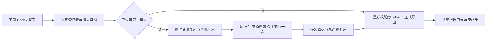

# Codex 跨聊天复用与容量管理 V1

2026-10-25。实施范围为聊天入口、固定运行位置、任务与正式导出复用、容量盘点及准入。用户确认旧大数据已清理，授权先用隔离样本验证。本轮没有重建生产环境、下载全市场数据或启动服务。

## 日常怎么工作

Codex 使用新增 `scripts/codex_chat.py`，从所有聊天共用的私有登记表定位现有 API 或 standalone 环境。登记不是数据来源证明，也不安装 Python、初始化业务数据库或复制源目录。旧 `scripts/codex_research.py` 参与策略 source hash，保留原字节；新入口导入其正式选择和校验逻辑。



先查询原结果，再确认是否需要新采集或计算。重复请求命中后仍核验来源、配置、日期及产物；UNKNOWN、FAILED、陈旧和未执行分别保留，不把原结果改日期或升级为新来源。

API 登记绑定实际 `/health/ready` 返回的 DB/state。503 可以携带真实实例身份，不代表数据已就绪。提交前检查最多100条原作业：唯一精确匹配的活动作业继续跟踪；其他活动作业或窗口已满则拒绝新提交。后台作业的最终状态由原服务负责。

standalone 登记直接调用既有解释器和 `scripts/stockfish.py premarket`，沿用原配置、缓存、排他锁、worker 预算、归档校验和实际日历门禁。venv 的 Python 调用路径保留，另绑定其真实可执行文件。默认不把任意旧 `latest-job.json` 接纳为已登记回执；已登记的成功任务才能跨聊天重新认证后复用。

## 一次性登记，由 Codex 完成

模板为 [API](../config/codex-chat-api.example.json) 和 [standalone](../config/codex-chat-premarket.example.json)。模板中的占位路径必须替换为实际存在、核实过的私有路径；standalone 原配置须显式包含相同的绝对 `state_root`。报告目录也须已经存在。源码、解释器与配置可以位于不同目录，数据根之间不能重叠或互为别名。

从 `stock-fish/` 使用已选择的解释器执行；全局参数放在子命令前：

```sh
python scripts/codex_chat.py runtime-status
python scripts/codex_chat.py runtime-register --config PRIVATE_RUNTIME.json --default
python scripts/codex_chat.py storage-status
python scripts/codex_chat.py status
python scripts/codex_chat.py list
```

默认登记根为 `${XDG_STATE_HOME:-~/.local/state}/stockfish/codex-chat`。也可固定设置 `STOCKFISH_CHAT_STATE` 或 `--registry-root`；**不得按聊天ID建立新登记表**。用 `--runtime NAME` 或 `STOCKFISH_CHAT_RUNTIME` 明确选择实例。不同实例可以有名字，但同一物理资源的容量策略与报告根必须一致，不能靠改名绕过去重或配额。

名字、默认指向及已登记位置不静默覆盖。原目录或 DB 被替换、Python 被重定向时拒绝继续使用；路径变化需要重新核实身份，不能编辑回执来冒充原运行。未登记的新入口返回 `UNCONFIGURED` 或 `RUNTIME_REGISTRATION_REQUIRED`，不会猜测8000端口或建立新业务库。

standalone 每次明确业务日期及稳定请求标识：

```sh
python scripts/codex_chat.py --runtime daily-premarket \
  --request-key premarket-2026-10-23-target-2026-10-26 \
  premarket --observation-date 2026-10-23 --target-session 2026-10-26
```

以上日期只演示语法，实际执行必须使用原日历认可的当期业务日期。跨聊天重述同一次请求时沿用同一 key；不要按当前秒钟生成 key，也不能跨交易日复用旧 key。API `capture` 及没有明确 input 的更新同样要求 key。新 key 不构成自动重试或扩大预算的授权。

原离线研究命令仍显式使用 `codex_research.py`；新入口不会把历史重放自动接入当日任务。用户通常只需在聊天中提出请求，无需手工运行以上命令。

## 去重、故障和证据

- 同一登记根内，DB、state、报告根和容量根按物理 device/inode 加锁。DB 硬链接或别名配置不能绕过锁。多个聊天并发时后者返回忙并跟踪原任务。
- 请求身份包括明确请求参数；standalone 还包括原源码闭包、配置、解释器、观察日和目标日。不同输入、策略或业务日期不会误命中。
- 外部提交前 fsync 保存 `SUBMITTING`。只有首次校验通过才保存 `RECORDED`；复用也重新校验。异常、中断或结果不明保留记录，拒绝自动二次提交。先核对服务原 job/standalone 原任务，确认是否完成及安全续行方式；不删除记录“解锁重试”。
- API 正式 JSON/CSV 复用前核远端原 hash、本地全部文件字节和原完整 summary 行序/数量。相同报告写入同一已验证目录；变更后的后验或附件有新内容时可产生新版本。显式 `--output` 仍是新目录导出，受同一容量政策限制，不承诺去重用户明确指定的多份导出。
- 元数据只记录位置、身份、预算摘要和小回执，不存完整行情、API 密钥或第二套候选数据库。没有 RAW 删除、自动 VACUUM、重新压缩原件或历史物理身份修复。

本层锁只协调新入口，不能承诺阻止外部程序或原服务 scheduler 的所有并发写入。API 回执确认的是入队及 job 身份，容量后观察也仅为接受时点，不能称后台作业已结束或最终占用已被硬限制。

## 容量规则

`storage-status` 仅遍历目录元数据，区分路径逻辑量、按 device/inode 去重的逻辑量及分配块。硬链接不重复计数；APFS 克隆/压缩/稀疏文件的逻辑量、分配块和真正可释放空间不是一回事，报告不声称某个差值可安全回收。

目录分 `protected/runtime/cache/output`。分类不授予删除权限；包含旧证据与新缓存的混合目录用 `runtime`，`protected` 不能作为新写入目的地。云占位、无权限、扫描中变化、路径别名、缺失、项数/深度超限均标 `PARTIAL` 并拒绝新写入，不伪装为空目录，也不打开占位文件触发下载。默认最多100万项、深度128；roots最多128，诊断路径与错误输出有严格大小上限。

每次新动作持锁检查：全部根的去重逻辑量加预计增长不能超 `max_managed_bytes`，实际 state/DB/report 目的卷扣掉预计增长后必须仍有 `min_free_bytes`。报告写入使用全部拟写文件的实际长度。模板 20 GiB 总量、10 GiB 余量、2 GiB 预计增长为初始示例，**尚未用真实每日工作量验证**。

这是写入前的保守准入，不是文件系统预留或硬配额。后台采集仍须保留原 worker 的请求、读取、时间与内存预算；其他应用占盘或实际增长超过预计值时不能保证不中途耗尽空间。扫描巨大目录也会耗时，本阶段没有偷偷缓存容量结果来省略真实检查。安全控制文件 I/O 与目录扫描在 macOS/POSIX 验证；Windows 未验收，安全扫描不可用时关闭新写入。

## 2026-10-25 隔离实测

样本均为 `TEST_FIXTURE`，不是股票行情。没有接触真实业务 DB、调用数据供应商或清理历史资料。本轮真实业务数据释放量为 **0**；下面测的是避免新增的重复数据。

| 实测 | 原重复流程 | 共享流程 | 结果 |
|---|---:|---:|---|
| 两个新进程，8 MiB 基库副本 | 新增16 MiB | 0 | 避免16 MiB副本 |
| 两个新进程，各产生8 MiB相同输出 | 新增16 MiB | 8 MiB | 避免8 MiB重复输出 |
| 包含登记表、配置及操作回执的净新增逻辑量 | — | — | 少25,160,703字节，约24 MiB |
| 模拟计算动作 | 2次 | 1次 | 第二进程完整校验后复用 |
| 上述两次进程合计墙钟 | 1.212130秒 | 0.639527秒 | 少0.572603秒；每动作含人工0.2秒等待 |
| localhost正式导出，第二次大export GET | 重新取JSON和CSV | 0次 | 避免8,389,208字节响应 |
| localhost正式导出，重复报告新增文件 | 原首份8,390,145字节 | 0 | 同一目录复用 |
| localhost正式导出耗时 | 首次0.122506秒 | 重复0.131059秒 | 增加0.008553秒，未证明提速 |

协调样本使用4个独立新进程，保留共同8 MiB源文件不计节省。网络被审计钩子拒绝。时长包括进程启动、复制、人工等待和完整结果校验，不包括一次性夹具准备与登记；单次样本有系统调度波动，不外推真实策略速度。空间数字包含一次性登记成本，块分配另计，不能换算为已经释放的真实磁盘容量。

API样本是实际 localhost HTTP 与文件 I/O，8 MiB人为填充。第二次仍执行来源及完整导出一致性验证，因此本地读取并不保证比第一次HTTP快。它证明减少大响应和重复落盘，没有证明全市场取数或盘前计算提速。原 DB 字节和物理身份保持。

原样本JSON保存在私有 `reports/codex/chat-workspace-20261025/`，不提交真实运行路径或私有审阅包。协调测量可复现：

```sh
python -I -B scripts/benchmark_codex_chat_fixture.py
```

## 工程验证与未执行范围

本机CPython3.12.14独立临时venv；测试依赖与应用环境分开，没有安装或更改生产运行环境。从 `stock-fish/` 执行：

```sh
python -B -m unittest discover -s tests/unit -p 'test_codex*.py' -v
python -I -B scripts/run_isolated_tests.py -q tests/r05_product/test_codex_research.py
```

最终组合：新增4组共 **89项通过，42.651秒，退出0**；旧入口回归 **62项通过，20.93秒，退出0**。两条命令分别报告，不称全仓检查。覆盖真实子进程并发、首次锁文件创建竞争、进程崩溃、提交不明、回执篡改、容量超限、云占位、错误实例、源hash变化、过期日期、UNKNOWN保持、venv调用路径以及正式附件报告复用。

发布前在真正的发布检出目录再执行以下定向组合，**151项与48个子断言通过，44.64秒，退出0**。开发目录一份与本任务无关的 `native_r2_upstream_v1.py` 改动未同步，故以发布目录复验作为最终发布检查：

```sh
python -I -B scripts/run_isolated_tests.py -q \
  tests/unit/test_codex_capacity.py tests/unit/test_codex_workspace.py \
  tests/unit/test_codex_premarket.py tests/unit/test_codex_workspace_api.py \
  tests/r05_product/test_codex_research.py
```

早期85项组合曾有1项并发锁文件创建错误；改为排他创建与已存在打开分支，无法取得锁时拒绝动作，并加入首次创建竞争回归后通过。旧入口回归前两次因临时测试环境缺Flask、NumPy分别出现1失败/61通过；按仓库版本补齐隔离依赖后全62通过，没有跳过失败项或弱化断言。

本轮没有重跑全仓测试、恢复旧数据来源、执行真实盘前采集、验证Windows、改策略或证明投资优势。冻结核心与旧入口最终字节不变；开发过程中旧入口曾暂改后恢复字节，其开发文件mtime/ctime已变化，不声称恢复原物理身份；发布检出中的旧文件从未写入。

后续真实环境恢复后，再测“最新交易日增量采集”和“首次盘前全链”耗时；进一步优化历史复权重复请求、题材分区、JSON全文往返与内容寻址归档。任何改变证据存储或来源认证的工作须按独立版本和真实等价性验收，不能拿本阶段去重收益替代这些工作。
